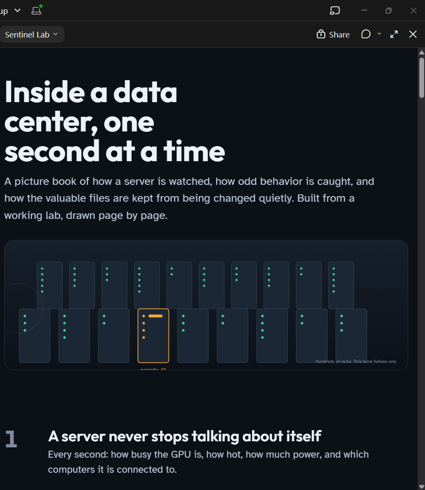

# Sentinel Lab

**Inside a data center, one second at a time.**

A visual walkthrough of GPU telemetry, network traffic, anomaly detection, and
data security. Follow one server through its sensors, detection rules, access
checks, and evidence verification.



[Telemetry walkthrough source](site/index.html) ·
[Security walkthrough source](site/security.html)

The image above is a preview. To open the full animated walkthrough, run this
from the repository root and visit **http://127.0.0.1:8000**:

```bash
python -m http.server 8000 --bind 127.0.0.1 --directory site
```

The walkthrough is a static explanation; running the live traffic experiments
uses the separate Docker commands below.

## Data center telemetry and security

This repository studies GPU metrics, anomaly detection, and network security in a
local data-center lab. It combines simulated GPU observations with actual Zeek
connection logs and OpenCanary events. It retains the original classical and
quantum anomaly-detection benchmark.

Start with [GPU metrics and security](docs/10-gpu-metrics-and-security.md), then
the [local experiments](docs/09-local-security-lab.md). The
[code and API reference](docs/11-code-reference.md) describes the implementation
and the interfaces used by optional clients. The illustrated walkthrough lives
under `site/`.
[Data security and integrity](docs/13-data-security-and-integrity.md) covers the
asset inventory, access policy, authenticated baselines, and sealed evidence bundles.
[AWS architecture](docs/12-aws-architecture.md) is a proposal only; nothing is deployed.
[Security results](docs/security-results.md) records commands actually run,
observed outcomes, and checks that could not run on the current machine.

## Run the local experiments

The two-minute test cycle generates
normal work, an approved training job, a cooling fault, decoy probes, recurring
connections, unapproved compute, and recovery. Findings retain supporting evidence IDs.

With Docker Desktop running Linux containers, run from this repository:

```bash
docker compose -f compose.lab.yml up --build -d
```

An optional diagnostic viewer runs at **http://localhost:8765**. The first build
downloads Python dependencies and sensor images. Only this viewer is published,
on loopback; all traffic targets are inside the isolated Docker network.

```bash
docker compose -f compose.lab.yml ps
python scripts/verify_lab.py
docker compose -f compose.lab.yml down
```

The demo reuses the existing window features and Isolation Forest. GPU readings
and job attribution are simulated; network and decoy observations are real.
Recovery stops scenario traffic generation; it does not enforce network quarantine.
AWS services and real GPU exporters are future integration work. See the
[local lab guide](docs/09-local-security-lab.md) for architecture, commands, and expected evidence.

After installing the package, analysis also runs without a browser:

```bash
python -m qdc_anomaly.lab describe
python -m qdc_anomaly.lab inspect --evidence lab/runtime
python -m qdc_anomaly.lab replay --input evidence.json --out replay.json
```

Asset baselines and evidence sealing. The key, baselines, and audit log go under
`security/local/` (ignored by git, outside the asset root):

```bash
python -m qdc_anomaly.security keygen
python -m qdc_anomaly.security baseline --approved-by publisher
python -m qdc_anomaly.security verify
python -m qdc_anomaly.security access-demo
python -m qdc_anomaly.security seal-evidence --input evidence.json --out evidence.sealed.json
python -m qdc_anomaly.security verify-evidence --input evidence.sealed.json
```

Actor names are labels, enforcement covers only calls through the guarded store,
and HMAC authentication depends on a local key file. See the security doc for limits.

## The analytics pipeline

```
rack metrics   ->   10 minute windows   ->   4 numbers per window   ->   detector   ->   anomaly score
(cpu, temp, fan, ...)                                                       |
                                          classical:  isolation forest, one class SVM, PCA
                                          quantum:    quantum kernel SVM, quantum autoencoder
```

Every detector gets the same four numbers and is scored the same way. So any difference in the results comes from the detector, not from the data prep.

## Why data centers

Every server rack reports CPU, memory, temperature, fan speed, power, network and disk. Problems like a dying fan or a memory leak do not trip a simple threshold; they show up as the *relationship* between metrics going wrong (temperature too high for the current power draw, for example). That is an anomaly detection problem.

It is also a good fit for today's small quantum computers: the data is a few continuous numbers, which maps directly onto a few qubits. Both quantum models here use 4 qubits.

## Quick start

Terminal (PowerShell or bash, from the repo folder):

```bash
pip install -e ".[dev,plots]"
make test-fast          # classical tests, a few seconds
make test               # adds the quantum tests, about a minute
make benchmark-quick    # small end to end run, a couple of minutes
make benchmark          # full run, writes results/report.md
```

Or with Docker:

```bash
docker build -t qdc-anomaly .
docker run --rm -v "$PWD/results:/app/results" qdc-anomaly
```

## What is inside

| Folder | What it does |
|---|---|
| `site/` | Illustrated Sentinel Lab walkthroughs covering telemetry and data security |
| `src/qdc_anomaly/data/` | Makes synthetic telemetry with labeled faults; reconstructed generator, see the results log |
| `src/qdc_anomaly/lab/` | Local security demo, GPU simulator, sensor normalization, and dashboard |
| `src/qdc_anomaly/security/` | Asset inventory, access policy, HMAC-authenticated baselines, evidence sealing, audit records |
| `security/` | Declared sample assets, inventory, and policy used by the integrity experiments |
| `docs/12-aws-architecture.md` | Proposed AWS mapping (EC2, VPC, CloudWatch, S3, IAM, KMS, CloudTrail, SSM, optional Braket); not deployed |
| `compose.lab.yml` | Isolated worker, API, test receiver, Zeek, OpenCanary, and dashboard |
| `src/qdc_anomaly/features/` | Turns the time series into windows and shrinks each window to 4 numbers |
| `src/qdc_anomaly/detectors/` | The five detectors, all with the same `fit` and `score` methods |
| `src/qdc_anomaly/evaluation/` | Scoring and the benchmark that compares everything |
| `configs/default.yaml` | Every setting in one file |
| `docs/` | The lessons, in order |
| `notebooks/walkthrough.ipynb` | The whole pipeline in one notebook |
| `tests/` | Checks that each piece does what it says |

## Lessons

Read these in order. Each one is short and points at the code it explains.

1. [What problem are we solving](docs/01-problem-framing.md)
2. [How the fake telemetry is made](docs/02-telemetry-simulation.md)
3. [Getting the data ready for qubits](docs/03-features-for-qubits.md)
4. [The classical detectors](docs/04-classical-baselines.md)
5. [Quantum kernels, explained simply](docs/05-quantum-kernels.md)
6. [The quantum autoencoder](docs/06-quantum-autoencoder.md)
7. [Comparing fairly](docs/07-honest-benchmarking.md)
8. [Running on a real quantum computer](docs/08-running-on-hardware.md)

## Command line

```bash
qdc generate  --out data/telemetry.csv                       # make a dataset
qdc benchmark --config configs/default.yaml                  # compare all detectors
qdc benchmark --detectors isolation_forest quantum_autoencoder --set quantum.epochs=20
qdc score     --input data/telemetry.csv --detector quantum_kernel_svm --out results/scores.csv
```

Change any setting with `--set section.key=value`.

## Adding your own detector

Subclass `AnomalyDetector` (two methods: `fit` and `score`), add it to the list in `detectors/__init__.py`, write one test. It then shows up in the CLI and the benchmark automatically.

## What to expect

The quantum models are not expected to beat the classical ones on a laptop simulator. The goal is a fair, readable comparison so you can see where a quantum approach helps, where it does not, and what it costs in time.

## License

MIT.
